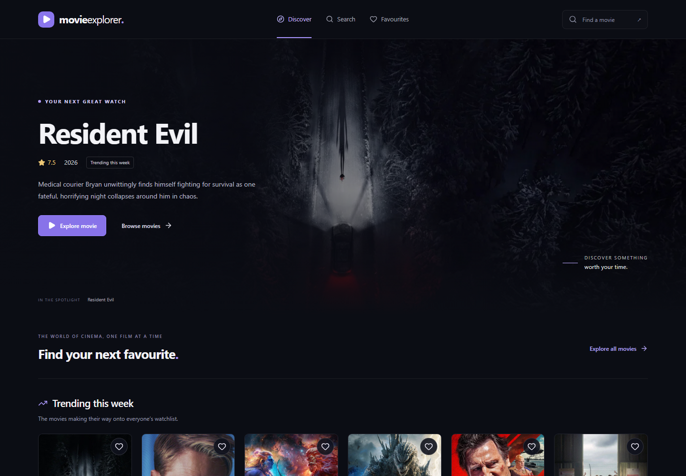
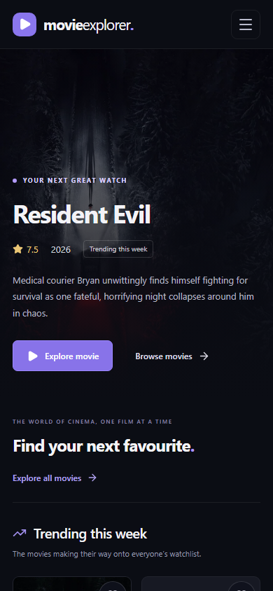
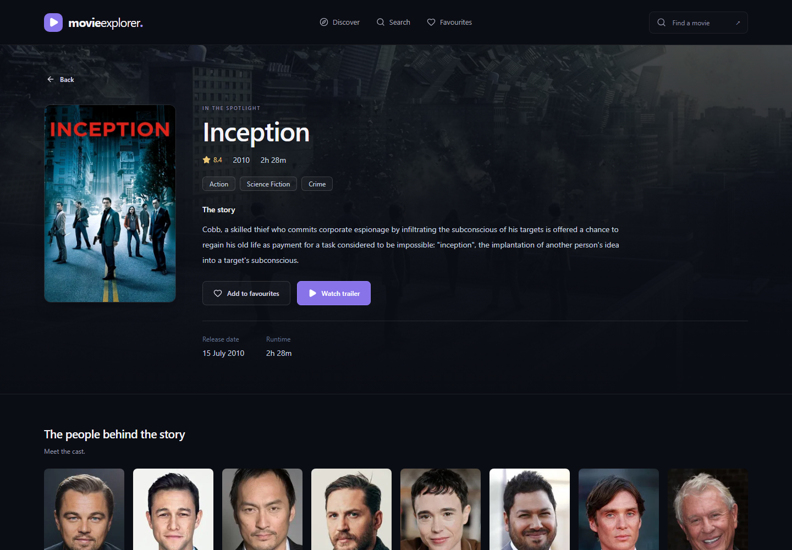

# Movie Explorer

A React app for discovering movies, searching by title, exploring cast and trailers, and keeping a personal list of favourites. Built around the four modules in the included Movie Explorer curriculum.

AI assistance was used during development. The code stays in plain JavaScript, with the main implementation decisions explained below.

[Live website](https://movie-explorer-pi-two.vercel.app) · [GitHub repository](https://github.com/poojaaxx/movie-explorer)

## Features

- A featured trending movie, weekly trending picks, and popular movies from TMDB.
- Search with a 450 ms debounce, shareable query URLs, and pagination.
- Detail pages with overview, genres, runtime, release date, cast, official trailers, and recommendations.
- Favourites shared across components, saved in localStorage, and synchronized across tabs.
- Infinite scrolling for popular movies, with a manual load button as a fallback.
- Responsive navigation, keyboard focus styles, reduced-motion support, image fallbacks, skeletons, and retry states.
- A server-side TMDB proxy that keeps the access token out of the browser.

## Stack and structure

React 19, Vite 8, JavaScript/JSX, React Router, Tailwind CSS 4, Lucide React, native fetch, Context, Vitest, and React Testing Library. Vercel serves the frontend and one Node.js API function. There is no database or user account system.

```text
api/tmdb.js             Validated TMDB proxy, used locally and on Vercel
src/components/         Cards, feedback states, navigation, and popular movie feed
src/context/            Favourites provider and context
src/hooks/              Requests, debounce, favourites, and infinite loading
src/pages/              Home, search, details, favourites, and 404
src/services/tmdb.js    Same-origin fetch requests and normalized errors
src/utils/movies.js     Image URLs and display formatting
src/test/               Shared test setup
vite.config.js          React, Tailwind, local API middleware, and test settings
vercel.json             Vite build settings and SPA routing
```

## Run locally

Use **Node.js 24 LTS** and npm. Older Node versions, including Node 20.11, cannot run this toolchain.

```bash
git clone https://github.com/poojaaxx/movie-explorer.git
cd movie-explorer
npm ci
```

Copy `.env.example` to `.env.local`. On Windows PowerShell:

```powershell
Copy-Item .env.example .env.local
```

Open `.env.local` in your editor and paste your **TMDB API Read Access Token** after the equals sign:

```dotenv
TMDB_READ_ACCESS_TOKEN=
```

Use the read access token rather than the shorter API key. Do not add a `VITE_` prefix: those variables are included in browser code. Both `.env.local` and local deployment credentials are ignored by Git. Restart the development server after changing the token.

```bash
npm run dev
```

Open the local URL printed by Vite, normally `http://127.0.0.1:5173`. The Vite middleware runs the same handler as the Vercel function. A plain static file server will not run the API.

```bash
npm run build
npm run preview
```

Preview also includes the local API middleware and reads `.env.local`.

## How the four modules work

1. **Discovery:** `Home.jsx` uses `useRequest` for trending data. `requestMovies` calls `/api/tmdb`; the server validates the request and adds the bearer token. The hook keeps loading, error, retry, and cancellation logic together. `MovieCard` receives a movie through props.
2. **Search:** `useDebounce` resets a timer whenever the input changes. `Search.jsx` stores the input and page in URL parameters, waits 450 ms, and hides results from the previous query. `useRequest` aborts its old request and checks request identity so an older response cannot replace newer results.
3. **Details and routing:** `MovieDetails.jsx` reads and validates `useParams().id`. The proxy appends credits, videos, and recommendations to one details request. Only official YouTube trailers with a valid video key can create an iframe, and YouTube loads after a play click. `RouteEffects` updates the title and scroll position on navigation.
4. **Favourites and scrolling:** `toggleFavourite` updates Context and writes a small movie snapshot to localStorage. Storage failures are shown on the favourites page without breaking the in-memory list. `useInfiniteMovies.loadNextPage` locks requests before React renders, merges results using a `Set`, and stops at the final page. `PopularMovies` observes a sentinel 400 px before it enters view and disconnects the observer during cleanup.

For a project review, start with those functions and explain why effect cleanup, stable request identity, and a synchronous request lock solve different problems. Favourites are browser-local; they do not sync between devices.

## API decisions

Browser → `/api/tmdb` → TMDB. The browser never needs the TMDB token.

The proxy allows only trending, popular, search, and details requests. It validates endpoint-specific parameters, rejects duplicates, limits pages to 1–500, fixes the upstream host, and uses a 10-second timeout. Discovery and details can be cached briefly on Vercel; searches and errors use `no-store`. Error responses do not include upstream authentication details.

This is a public read-only proxy, so it is still subject to TMDB and Vercel usage limits. It is not an authenticated private API or a distributed rate limiter. Movie posters load directly from TMDB's image CDN. [TMDB API documentation](https://developer.themoviedb.org/docs/getting-started)

If TMDB is unreachable locally, check connectivity before replacing credentials. On networks where TMDB is blocked, the local proxy may need an existing working connection such as Cloudflare WARP. The deployed proxy runs on Vercel and does not depend on your laptop's connection. Images still depend on the visitor being able to reach TMDB's image CDN.

## Checks

```bash
npm run lint
npm run test
npm run build
```

Verified on 5 November 2026: lint and build passed, all 117 automated tests passed, and 36 production browser checks passed across desktop and mobile. The browser checks included real API data, search, details, trailers, favourites after reload, infinite scrolling, and nested-route refreshes.

Tests cover API validation and failures, cards, request races and cancellation, debounce/search, details and routing, favourites and storage failures, and infinite-scroll boundaries. They mock TMDB for repeatable checks; they do not prove external service availability. `npm run test:watch` runs tests while editing.

The test runner uses one worker to keep startup reliable on the Windows development machine. A `minimatch` override selects the patched 11.x release used by the current lint tooling; this avoids the advisory affecting its older dependency. The lockfile records the tested versions.

## Screenshots

Actual browser captures using TMDB data:



<details>
<summary>Mobile layout</summary>



</details>

<details>
<summary>Movie details</summary>



</details>

## Deploy to Vercel

Use a free **Hobby** account and import `poojaaxx/movie-explorer`. Choose the Vite framework, `npm run build` as the build command, `dist` as the output directory, and Node.js 24.x. Add `TMDB_READ_ACCESS_TOKEN` in the project's server-side environment settings for Production and Preview. Redeploy after changing it. Never put the token into a build command or a `VITE_` variable.

The root `api/tmdb.js` becomes a serverless function. The SPA rewrite excludes `/api`, so refreshing `/movie/123` or `/favourites` loads React while missing API routes return 404 responses. `.vercelignore` excludes local secrets, tools, and tests from deployment. [Vercel's Vite guide](https://vercel.com/docs/frameworks/frontend/vite)

## Limitations and next steps

- Availability, artwork, ratings, and trailers depend on TMDB. Some films have incomplete metadata.
- Favourites store a snapshot; their titles and ratings update when you remove and save a movie again. Clearing browser storage removes the list.
- Search pagination and infinite popular browsing stop at TMDB's 500-page limit.
- Useful next additions would be genre filters, a separate watchlist, and an import/export option for favourites.

## Credits

Movie information and artwork are provided by [TMDB](https://www.themoviedb.org). This product uses the TMDB API but is not endorsed or certified by TMDB.

The included TMDB logo is the official asset linked in the [TMDB attribution documentation](https://developer.themoviedb.org/docs/faq). Movie Explorer uses its own branding.
